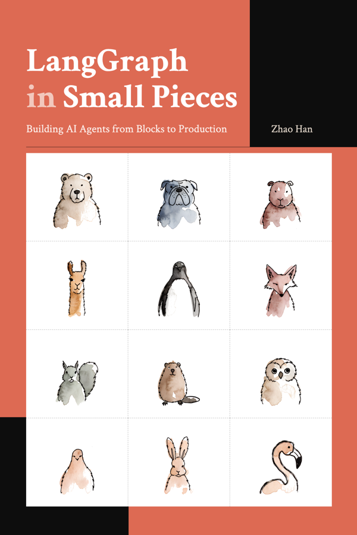

<p align="center">
  <a href="https://lgisp.ai"></a>
</p>

# LangGraph in Small Pieces — Code

**Read the book free online: [lgisp.ai](https://lgisp.ai)**

Companion code for the book **_LangGraph in Small Pieces: Building AI Agents from
Blocks to Production_**. One runnable file per chapter, plus worked solutions for
every end-of-chapter Challenge.

Everything runs on your own machine — no API keys, no cloud model bill. Part I
needs nothing but LangGraph; Parts II–III add a local model served by
[LM Studio](https://lmstudio.ai) and a local Chroma vector store. Almost all of it
is fully offline; the exceptions are the few examples that do a *real* web search —
Chapter 11's Gold challenge and Chapter 14 use DuckDuckGo via the `ddgs` package —
which need a network connection, but still no API key and no bill.

## Layout

```
code/
  ch00_setup.py … ch31_trajectory.py  # one runnable example per chapter
  answers/                          # worked Challenge solutions (self-testing)
    README.md
    ch01_*.py …
requirements.txt                    # exact pinned versions (Python 3.11)
```

The filename maps to the chapter: `ch16_streaming.py` is Chapter 16. A few
chapters ship more than one file where they contrast two approaches (e.g.
`ch11_handwritten_loop.py` vs `ch11_react_agent.py`).

## Setup

```sh
python3.11 -m venv .venv
source .venv/bin/activate          # Windows: .venv\Scripts\activate
pip install -r requirements.txt
```

Tested on **Python 3.11** with **LangGraph 1.2.14 / langchain-core 1.6.9**. The
versions in `requirements.txt` are pinned as a *set* — installing the latest of
any one package (say `langchain-openai`) can pull an incompatible `langchain-core`,
so install from the lockfile rather than piecemeal.

The book is a snapshot of those versions; [`COMPATIBILITY.md`](COMPATIBILITY.md)
is the living part -- every place where the book reports a behaviour the
documentation describes differently, or leans on something the library does not
promise, and what later releases changed.

### For Parts II–III: a local model

Chapters 10 and up call a real LLM. The book runs it locally through LM Studio's
OpenAI-compatible server:

1. Install LM Studio, then download a chat model (the book uses
   `qwen/qwen3.8-27b` and `openai/gpt-oss-20b`) and an embedding model
   (`text-embedding-nomic-embed-text-v1.5`). Install Qwen3.8 from the LM Studio
   catalogue (`lms get qwen/qwen3.8-27b`), not from a Hugging Face URL: the
   catalogue entry carries the thinking switch the code turns off with
   `reasoning_effort="none"`.
2. Start the server: `lms server start` (listens on `http://localhost:1234/v1`).
3. On a memory-constrained machine, don't run several model-backed examples at
   once — LM Studio unloads and reloads models when you switch, which can cancel
   an in-flight request. Run them one at a time.

Because the model is a real one, its exact wording and scores vary run to run and
across model versions; the *framework* behavior (routes, state, exit codes) is
stable, the model's prose is not.

## Running an example

```sh
python code/ch01_minimal_graph.py
```

Each Challenge answer is self-contained: it holds the solution *and* its tests, so
running the file both demonstrates the idea and checks it still works (details in
[`code/answers/README.md`](code/answers/README.md)).

```sh
# runs a short demo, then its assertions, and prints "all N tests passed"
python code/answers/ch01_typeddict_no_validation.py
```

## License

MIT — see [LICENSE](LICENSE). Code is free to use; the book's prose is the
separate, authored companion.
